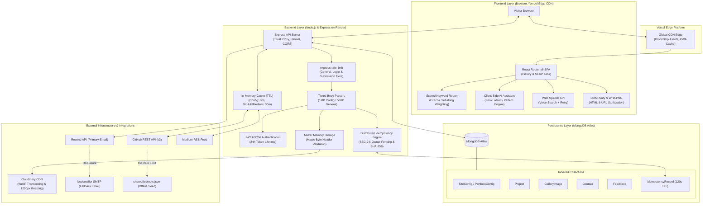

<div align="center">

# googleMe

### A Google-inspired, full-stack developer portfolio and headless content management system engineered for intent-driven search, fast client-side navigation, and resilient operations.

[](https://www.anuragjaiswal.me)
[](https://github.com/anurag-jaiswal-aj/googleMe/actions/workflows/ci.yml)
[](https://github.com/anurag-jaiswal-aj/googleMe)
[](https://nodejs.org/)
[](LICENSE)

<br />

<p align="center">
  
</p>
<p align="center"><sub>Audit snapshot taken from <code>./lighthouse.png</code> against a production build. Live scores vary depending on client network conditions, device capabilities, and geographic routing.</sub></p>

[Live Demo](https://www.anuragjaiswal.me) · [Architecture](#system-architecture) · [Feature Showcase](#feature-showcase) · [Engineering Deep Dives](#engineering-deep-dives) · [API Reference](#api-reference) · [Local Setup](#getting-started) · [Security & Testing](#security-hardening-testing--ci)

</div>

---

## Executive Summary

**googleMe** reimagines the developer portfolio from a passive, linear-scroll presentation into an interactive, intent-driven **Search Engine Results Page (SERP)**. Rather than forcing recruiters and engineers through arbitrary vertical sections, googleMe provides an authentic Google search interface with scored keyword routing, sticky tab navigation, contextual knowledge panels, voice search, a lightweight client-side AI assistant, and a full-featured admin CMS.

Behind the Google-themed aesthetic lies a hardened MERN architecture backed by **386 automated integration tests** (153 client + 233 server), distributed submission idempotency with worker lease fencing (SEC-24), dual-channel email failover (Resend primary with Nodemailer SMTP fallback), magic-byte media verification, WHATWG URL canonicalization, and dynamic in-memory caching with automatic invalidation. Fast content discovery is an architectural design goal achieved through in-memory scored routing and edge static asset delivery rather than an unverified synthetic benchmark.

---

## Product Vision & Architecture Philosophy

### The Problem with Traditional Portfolios
Conventional developer portfolios are built like static landing pages. They rely on vertical infinite scrolls, bloated JavaScript libraries, and unstructured narrative layouts. For a hiring manager or technical recruiter reviewing dozens of candidates:
1. **High Discovery Friction:** Finding a specific skill, repository link, or educational credential requires scrolling through multiple viewport heights of animations.
2. **Static & Fragile:** Content updates require source code edits, commits, and redeployments, leading to abandoned or out-of-date portfolios.
3. **Superficial Engineering:** Frontends often mask absent backend systems, lacking authentication, persistent data models, rate limiting, and automated testing.

### The googleMe Approach: Intent-Driven Discovery
googleMe treats portfolio browsing as a search problem:
- **Zero-Friction Navigation:** Typing `"resume"`, `"github"`, `"skills"`, `"contact"`, or `"projects"` immediately routes the visitor to the corresponding result view via a scored keyword heuristic.
- **SERP Fidelity:** Every view preserves authentic Google search UX patterns, including breadcrumb hierarchies, sitelinks, a collapsible Knowledge Graph panel, filter tabs, and responsive search bars.
- **Decoupled Headless CMS:** An integrated, authenticated management panel (`/admin`) allows dynamic editing of bio details, work history, skill taxonomy, pinned GitHub repositories, gallery media, and page visibility toggles without touching code.
- **Fail-Closed Reliability:** Server startups abort if required indexes or secrets are uninitialized, media uploads enforce binary header inspection, and external API requests fall back to deterministic static fixtures if third-party services degrade.

---

## System Architecture

googleMe is structured as a decoupled full-stack application. The frontend is a single-page application (SPA) deployed to Vercel's global edge network, while the backend is an Express API running on Render backed by a MongoDB Atlas cluster, Cloudinary media CDN, and dual email dispatch providers.



### Request Flow & Execution Boundaries
1. **Client-Side Processing:** Search scoring, query autocomplete filtering, Web Speech voice capture, AI chat pattern evaluation, and 3D avatar flips run entirely in browser memory with zero server round-trips.
2. **Edge CDN Distribution:** Static bundles, route chunks, compressed assets (Brotli/Gzip), and PWA service worker manifests are served via Vercel's global edge network.
3. **Synchronous Backend Boundaries:** Admin authentication, configuration updates, and gallery mutations run synchronously against MongoDB and Cloudinary.
4. **Asynchronous & Resilient Background Tasks:** Contact form and feedback submissions acquire distributed idempotency locks, persist payloads, verify worker lease ownership, and dispatch email notifications via Resend with automatic fallback to Nodemailer SMTP.

---

## Feature Showcase

| Feature Area | User Capability | Implementation Architecture | Verification Status |
|---|---|---|---|
| **Google SERP Interface** | Sticky search header, category tabs (All, About, Projects, Blog, Tools, Images, Contact), breadcrumbs, sitelinks | React Router v6, Tailwind CSS, sticky positioning, responsive layout | Fully Implemented & Verified |
| **Smart Search Router** | Types keywords like `"resume"`, `"hire"`, `"github"`, routes to correct tab | Scored priority algorithm (`exact * 2 + len` vs `partial + len * 0.5`) with visibility fallback | Fully Implemented & Verified |
| **Voice Search** | Dictate search queries via microphone | Native Web Speech API (`SpeechRecognition`) with permission handling & network auto-retry | Fully Implemented & Verified |
| **Google Lens Modal** | Upload or drag-and-drop image preview to simulate visual search | Client-side drag-and-drop & URL preview modal (`"visual search coming soon"`) | Implemented UI Simulation |
| **AI Chat Assistant** | Instant answers to portfolio questions via sparkle icon | Client-side pattern-matching engine with dynamic context injection from admin config | Fully Implemented & Verified |
| **Knowledge Panel** | Google Knowledge Graph display with bio, education, experience, skills chips | Desktop right rail, collapsible mobile drawer, interactive 3D CSS flip avatar | Fully Implemented & Verified |
| **Admin CMS Panel** | Manage all portfolio content, links, bio, and experience at `/admin` | JWT HS256 auth, bcrypt password verification, MongoDB persistence, cache eviction | Fully Implemented & Verified |
| **Dynamic Visibility** | Enable or disable entire pages (Blog, Tools, Images) on the fly | Admin toggle in `pageVisibility` config; auto-updates navigation and search routing | Fully Implemented & Verified |
| **Live GitHub Sync** | Sync public repositories and curate pinned portfolio projects | Node-cache proxy (30m TTL), personal access token support, static JSON fallback | Fully Implemented & Verified |
| **Medium RSS Integration** | Read published articles in an integrated, clean in-app reader | `rss-parser` backend proxy (30m TTL), DOMPurify sanitization stripping tracking pixels | Fully Implemented & Verified |
| **Idempotent Contact Form** | Submit inquiries with subject chips, honeypot spam protection, attachments | RFC 4122 UUID keys, distributed locking, magic-byte inspection, dual email failover | Fully Implemented & Verified |
| **Feedback Widget** | Submit bug reports, feature requests, or compliments from any page | Multipart form, Cloudinary attachment storage, admin triage inbox (`/api/feedback`) | Fully Implemented & Verified |
| **Theme Engine** | Dark mode, light mode, and system preference detection | `ThemeContext` with OS media query listener, admin default override, safe localStorage | Fully Implemented & Verified |
| **PWA & Offline Precaching** | Install portfolio as a desktop/mobile app, offline asset caching | `vite-plugin-pwa` with Workbox precaching, custom manifest, and service worker | Fully Implemented & Verified |

---

## Engineering Deep Dives

### 1. Distributed Idempotency & Worker Lease Fencing (SEC-24)
- **Problem:** When submitting contact messages or feedback over volatile mobile networks, users frequently experience timeouts or repeatedly click submit buttons. Naive implementations risk duplicate database writes, repeated emails, or corrupted file attachments.
- **Implementation (`server/utils/idempotency.js` & `server/models/IdempotencyRecord.js`):**
  - Clients generate a cryptographically strong RFC 4122 v4 UUID (`Idempotency-Key` header).
  - The server verifies key format (`1-128` characters matching `^[A-Za-z0-9_.-]+$`).
  - An atomic record insertion locks the operation with an `in-progress` state and a unique `ownerToken`.
  - A SHA-256 canonical hash is computed across the request payload and binary attachment buffers. If a subsequent request arrives with the same key but modified payload data, the server immediately rejects it with `422 Unprocessable Entity`.
  - **Worker Fencing & Best-Effort Side-Effect Suppression:** Downstream workers check `isClaimOwner` prior to triggering external side-effects (such as email dispatch). If the worker's 120-second lease expired or was reclaimed, email dispatch is suppressed to significantly reduce duplicate delivery risk during retries. Because database persistence and third-party email APIs (Resend/SMTP) are distinct distributed systems that cannot participate in a single atomic transaction, the implementation provides at-most-once delivery suppression rather than a theoretical two-phase distributed guarantee.
  - **Collision Recovery:** If parallel workers attempt simultaneous inserts, MongoDB unique index collisions (`E11000`) cause the secondary worker to safely await the primary worker's cached response, destroying any orphaned Cloudinary upload buffers.

```
Client Request
      │  (Includes Idempotency-Key: <UUIDv4>)
      ▼
Compute SHA-256 Payload Hash (Body + Byte Buffers)
      │
      ├───────────────────────────────┬───────────────────────────────┐
      ▼                               ▼                               ▼
[New Key]                      [Matching Key: in-progress]     [Matching Key: completed]
Insert IdempotencyRecord        Check Worker Lease              Compare Request Hash
State: in-progress (TTL 120s)   ├── Active: Return 409 Conflict ├── Match: Return Cached 200/201
OwnerToken: <crypto-random>     └── Expired: Reclaim Lease      └── Mismatch: Return 422 Unprocessable
      │
Execute Controller Logic
      │
Verify isClaimOwner()
      ├── Owner Verified: Dispatch Email & Update Record to 'completed'
      └── Lease Lost: Suppress Email Notification & Abort
```

### 2. Scored Keyword Routing with Visibility Awareness
- **Problem:** Visitors use unpredictable search terminology. Static routing tables fail on synonyms or misspellings, while standard full-text search engines require heavy server round-trips for simple client-side navigation.
- **Implementation (`client/src/utils/searchRoute.js`):**
  - Search queries are scored across registered route definitions using a weighted priority function:
    $$\text{Score} = (\text{exact match} \times 2 + \text{keyword length}) + (\text{partial match} + \text{keyword length} \times 0.5)$$
  - High-confidence intent matches immediately route the user to the target tab (`"projects"`, `"github"`, `"repo"` $\to$ `/projects`; `"hire"`, `"email"`, `"reach"` $\to$ `/contact`).
  - **Visibility Awareness:** The search router evaluates the active `pageVisibility` state before redirecting. If an administrator has hidden a section (e.g., the Gallery or Tools page), query matches targeting that route gracefully fall back to `/all?q=...` instead of triggering a 404 error.

### 3. Defense-in-Depth Security & Media Hardening
- **Magic-Byte Binary Header Inspection (`server/utils/attachmentValidation.js`):**
  File extensions and MIME headers can be forged. All file uploads undergo magic-byte signature validation before acceptance:
  - PDF: `%PDF-` (`0x25 0x50 0x44 0x46 0x2D`)
  - JPEG: `0xFF 0xD8 0xFF`
  - PNG: `0x89 0x50 0x4E 0x47`
  - WebP: `RIFF....WEBP`
  - Any executable, SVG (XML vector injection risk), or polyglot file masquerading as a document is rejected with `400 Bad Request`.
- **WHATWG External Link Canonicalization (`client/src/utils/galleryUrl.js`):**
  External links associated with gallery items are validated via the native WHATWG `URL` parser:
  - Rejects `javascript:`, `data:`, `vbscript:`, protocol-relative `//`, and relative path inputs.
  - Rejects URLs containing embedded user credentials (`user:pass@host`).
  - Canonicalizes schemes and normalizes hostnames. All rendered anchors enforce `target="_blank"` and `rel="noopener noreferrer"`.
- **Strict HTML Sanitization (`client/src/utils/sanitizeHtml.js`):**
  Medium RSS article feeds contain raw third-party HTML. Content is processed through DOMPurify with strict attribute whitelisting, stripping inline script tags, active event handlers (`onerror`, `onload`), and tracking pixels.
- **Tiered Request Size Limits (`server/index.js`):**
  To prevent payload flooding while accommodating large administrative base64 payloads, the Express server enforces split JSON body parsers: `1 MB` for `/api/config` and `50 KB` for standard endpoints.

### 4. Dual-Channel Resilient Email Delivery Pipeline
- **Problem:** Email deliverability is critical for contact forms. Third-party transactional email providers (such as Resend) can experience regional outages, rate limit spikes, or domain verification delays.
- **Implementation (`server/utils/emailService.js`):**
  - When a message is submitted, the system attempts delivery via **Resend** (HTTP API, preferred).
  - If Resend credentials are unset, or if the API call encounters a network/HTTP error, the system automatically falls back to **Nodemailer SMTP** (e.g. Gmail over TLS/SSL on port 465).
  - All email triggers verify idempotency lease ownership before dispatch, guarding against rapid client retries and duplicate email delivery during concurrent worker execution.

### 5. In-Memory Caching & Automatic Eviction
- **Problem:** The GitHub REST API imposes a strict rate limit of 60 requests per hour for unauthenticated callers. Medium RSS feeds are subject to network latency and third-party rate limiting.
- **Implementation (`server/routes/github.js`, `server/routes/medium.js`, `server/routes/config.js`):**
  - GitHub repositories and Medium articles are cached in memory with a 30-minute time-to-live (TTL).
  - Site configuration is cached in memory with a 60-second TTL.
  - When an administrator modifies the `githubUsername` or `mediumUsername` via the `/admin` CMS, the backend automatically invalidates the corresponding external cache, ensuring that changes take effect immediately without requiring a server reboot.
  - If the GitHub API fails or exceeds rate limits, the server falls back to static fixtures stored in `shared/projects.json`.

---

## Technology Stack

### Frontend Architecture
- **Core Framework:** React 18.3.1 (Single Page Application)
- **Build Tooling:** Vite 5.4.21 with `@vitejs/plugin-react`
- **Routing:** React Router v6.30.6
- **Styling & UI:** Tailwind CSS 3.4.19, PostCSS, `@tailwindcss/typography`
- **Animations:** Framer Motion 11.0.8
- **Drag & Drop:** `@dnd-kit/core`, `@dnd-kit/sortable`, `@dnd-kit/utilities`
- **Sanitization & Security:** DOMPurify 3.4.16, native WHATWG URL API
- **SEO & Meta Management:** `react-helmet-async` 3.0.0
- **Compression & PWA:** `vite-plugin-compression` (Brotli & Gzip), `vite-plugin-pwa` 1.2.0 (Workbox 906 KiB precache)
- **Telemetry:** `@vercel/analytics` 2.0.1, `@vercel/speed-insights` 2.0.0

### Backend Architecture
- **Runtime:** Node.js (Engine: `>=22.22.0 <23.0.0`, CI runner: Node 22)
- **HTTP Framework:** Express 4.18.3
- **Security Middleware:** Helmet 7.1.0, CORS 2.8.5
- **Rate Limiting:** `express-rate-limit` 7.2.0 (Three-tiered: general, login, submissions)
- **Validation:** `express-validator` 7.0.1
- **File Uploads:** Multer 2.1.1 (Memory Storage) with binary magic-byte stream inspection

### Database & Persistence
- **Database Engine:** MongoDB 6.0+ (MongoDB Atlas in Production)
- **Object Modeling:** Mongoose 8.2.3
- **Key Schemas:** `SiteConfig`, `PortfolioConfig`, `Project`, `GalleryImage`, `Contact`, `Feedback`, `IdempotencyRecord`
- **Startup Integrity:** Fail-closed server initialization verifying all indexes (`Promise.all([Contact.init(), ...])`) before binding the HTTP port

### External Integrations & Storage
- **Media Hosting & Optimization:** Cloudinary 2.9.0 (auto-transcoding to WebP, 1200px responsive downscaling)
- **Primary Email Delivery:** Resend API (HTTP-based transactional delivery)
- **Fallback Email Delivery:** Nodemailer 10.1.0 (SMTP TLS/SSL on port 465)
- **Content Sources:** GitHub REST API v3, Medium RSS via `rss-parser` 3.13.0

### Testing & Infrastructure
- **Test Framework:** Node.js native test runner (`node:test`, `node:assert`)
- **Frontend Hosting:** Vercel Global Edge Network (SPA rewrite rules, custom security headers, CSP)
- **Backend Hosting:** Render Web Service (Proxy mode enabled, health monitoring)
- **Continuous Integration:** GitHub Actions (`ubuntu-latest`, Node 22, isolated `mongo:6.0` container)

---

## Repository Structure

```
googleMe/
├── .github/
│   └── workflows/
│       └── ci.yml               # GitHub Actions CI workflow (Node 22, MongoDB 6.0 service)
├── client/                      # React 18 + Vite frontend SPA
│   ├── public/                  # Static assets (Resume PDF, favicon.svg, sitemap.xml, robots.txt)
│   ├── src/
│   │   ├── api/                 # Axios HTTP client, auth interceptors, and typed API services
│   │   ├── components/          # Reusable UI (SearchLayout, KnowledgePanel, 3D Avatar, SearchResult)
│   │   ├── config/              # Default configuration constants and navigation links
│   │   ├── context/             # ThemeContext (dark, light, system preference resolution)
│   │   ├── data/                # Static fallback fixtures (bio, education, experience, tools)
│   │   ├── hooks/               # Custom hooks (useConfig, useVoiceSearch, useImagesPageEnabled)
│   │   ├── pages/               # Route views (Home, All, About, Projects, Blog, Tools, Images, Contact, Admin)
│   │   └── utils/               # Heuristics (aiChat, searchRoute, galleryUrl, sanitizeHtml, idempotency)
│   ├── test-*.js                # 10 standalone frontend test suites (153 automated tests)
│   ├── vercel.json              # Vercel deployment config (SPA rewrites, security headers, cache policies)
│   └── vite.config.js           # Vite bundling, PWA manifest, and Brotli/Gzip compression pipeline
├── server/                      # Express + MongoDB backend API
│   ├── middleware/              # Authentication middleware (strict HS256 JWT validation)
│   ├── models/                  # Mongoose schemas (SiteConfig, Project, GalleryImage, Contact, Feedback, IdempotencyRecord)
│   ├── routes/                  # Modular route controllers (adminAuth, config, contact, feedback, github, images, medium, projects)
│   ├── scripts/                 # Database seed utility (scripts/seed.js)
│   ├── utils/                   # Shared backend utilities (idempotency, emailService, attachmentValidation, imageValidation)
│   └── test-*.js                # 7 standalone backend test suites (233 automated tests)
├── shared/
│   └── projects.json            # Deterministic project fallback data for offline or rate-limited environments
├── lighthouse.png               # Verified Lighthouse audit score snapshot (95/98/96/100)
├── LICENSE                      # MIT Open Source License
└── package.json                 # Monorepo management scripts (dev, dev:server, dev:client, install:all, build, seed)
```

---

## Getting Started

### Prerequisites
- **Node.js:** `server/package.json` specifies `"node": ">=22.22.0 <23.0.0"`, aligned with CI (Node 22). (The active production runtime on Render is governed by host settings and cannot be verified from repository configuration alone.)
- **npm:** `>=10.0.0`
- **MongoDB:** A running local MongoDB instance (`mongodb://localhost:27017`) or a free [MongoDB Atlas](https://www.mongodb.com/atlas) cluster URI.
- **Cloudinary Account (Optional):** Free tier account for image uploads.
- **Resend or Gmail Account (Optional):** For contact form email notifications.

### 1. Clone & Install Dependencies
Clone the repository and run the root installation script, which sequentially installs dependencies across the root, `server/`, and `client/` directories:

```bash
git clone https://github.com/anurag-jaiswal-aj/googleMe.git
cd googleMe
npm run install:all
```

### 2. Configure Environment Variables
Copy the example environment configuration templates for both the server and the client:

```bash
cp server/.env.example server/.env
cp client/.env.example client/.env
```

#### Required Server Configuration (`server/.env`)
At startup, `server/index.js` enforces a fail-fast check requiring `MONGO_URI`, `JWT_SECRET`, and `ADMIN_PASSWORD_HASH`:

```env
PORT=5000
NODE_ENV=development
MONGO_URI=mongodb://localhost:27017/gfolio
ALLOWED_ORIGINS=http://localhost:3000,http://localhost:5173

# Generate a secure random 48-byte hex secret:
# node -e "console.log(require('crypto').randomBytes(48).toString('hex'))"
JWT_SECRET=your_long_random_jwt_secret_string

# Generate a bcrypt hash for your desired admin password:
# node -e "require('bcryptjs').hash('yourpassword', 10).then(console.log)"
ADMIN_PASSWORD_HASH=your_generated_bcrypt_hash
```

#### Full Server Environment Specification (`server/.env`)

| Variable | Required | Default | Description |
|---|---|---|---|
| `PORT` | Optional | `5000` | HTTP listening port for the Express API server. |
| `NODE_ENV` | Optional | `development` | Runtime environment (`development` or `production`). Governs rate limits and error stacks. |
| `MONGO_URI` | **Required** | — | MongoDB connection string (local instance or MongoDB Atlas cluster URI). Fail-fast startup requirement. |
| `ALLOWED_ORIGINS` | Optional | `localhost:3000,localhost:5173` | Comma-separated CORS allowed origins. |
| `VERCEL_PREVIEW_PATTERN` | Optional | — | Regex pattern matching trusted Vercel preview deployment URLs. |
| `JWT_SECRET` | **Required** | — | Secret string used for signing and verifying HS256 admin tokens. Fail-fast startup requirement. |
| `ADMIN_PASSWORD_HASH` | **Required** | — | bcrypt hash of the administrator password for `/admin` authentication. Fail-fast startup requirement. |
| `GITHUB_USERNAME` | Optional | `anurag-jaiswal-aj` | GitHub username used for syncing public repositories. Falls back to canonical username. |
| `GITHUB_TOKEN` | Optional | — | Personal Access Token (PAT) for higher GitHub API rate limits (5,000 req/hr). |
| `RESEND_API_KEY` | Optional | — | API key for primary email dispatch via [Resend](https://resend.com). |
| `RESEND_FROM` | Optional | — | Verified sender email address for Resend delivery. |
| `EMAIL_HOST` | Optional | `smtp.gmail.com` | SMTP host for fallback email delivery. |
| `EMAIL_PORT` | Optional | `465` | SMTP port for fallback email delivery (465 for SSL/TLS). |
| `EMAIL_USER` | Optional | — | SMTP account username or Gmail address. |
| `EMAIL_PASS` | Optional | — | SMTP App Password (do not use raw personal passwords). |
| `EMAIL_TO` | Optional | — | Destination email address to receive contact and feedback notifications. |
| `CLOUDINARY_CLOUD_NAME` | Optional | — | Cloudinary cloud name for media storage and image optimization. |
| `CLOUDINARY_API_KEY` | Optional | — | Cloudinary API key. |
| `CLOUDINARY_API_SECRET` | Optional | — | Cloudinary API secret. |

#### Client Configuration (`client/.env`)

| Variable | Required | Default | Description |
|---|---|---|---|
| `VITE_API_URL` | Optional | `http://localhost:5000/api` | API backend base URL. In production, auto-detects `https://googleme.onrender.com/api`. |

### 3. Seed Database (Optional)
To populate MongoDB with initial profile metadata, project cards, and categories:

```bash
npm run seed
```

### 4. Start Local Development
Start both the Express backend and the Vite frontend concurrently via the root script:

```bash
npm run dev
```

- **Frontend Client:** `http://localhost:3000` (or `http://localhost:5173` depending on Vite port allocation)
- **Backend API:** `http://localhost:5000`
- **Health Check:** `http://localhost:5000/api/health`

### 5. Run Automated Tests
Execute the comprehensive test suites across both workspaces:

```bash
# Run all 153 client tests (sanitizers, routing, visibility, theme, idempotency)
cd client && npm test

# Run all 233 server tests (uploads, auth, validation, security, idempotency)
cd server && npm test
```

### 6. Build for Production
Validate the production build and PWA bundle generation:

```bash
npm run build
```

---

## API Reference

The backend exposes a RESTful API with strict payload limits and structured error responses. All administrative endpoints require a valid JSON Web Token transmitted in the `Authorization: Bearer <token>` header.

### Authentication & Health

| Method | Endpoint | Auth | Request Payload | Success Response | Status | Error Codes |
|---|---|---|---|---|---|---|
| `GET` | `/api/health` | Public | None | `{ status: "ok", timestamp: string }` | `200 OK` | — |
| `POST` | `/api/admin/login` | Public | `{ password: string }` | `{ token: string }` | `200 OK` | `400`, `401`, `429` |
| `POST` | `/api/admin/verify` | Public | None (`Bearer <token>` header) | `{ valid: true }` | `200 OK` | `401 Unauthorized` |

### Site Configuration & CMS

| Method | Endpoint | Auth | Request Payload | Success Response | Status | Error Codes |
|---|---|---|---|---|---|---|
| `GET` | `/api/config` | Public | None | Key-value dictionary of site configuration | `200 OK` | `500` |
| `POST` | `/api/config` | Admin | `{ key, value }` or `{ updates: [...] }` | Updated configuration object | `200 OK` | `400`, `401` |
| `POST` | `/api/config/resume-upload` | Admin | Multipart `resume` file (`.pdf`) | `{ resumeUrl: string }` | `200 OK` | `400`, `401`, `500` |
| `POST` | `/api/config/avatar-upload` | Admin | Multipart `avatar` file (image) | `{ avatarUrl: string }` | `200 OK` | `400`, `401`, `500` |

### Projects & External Sync

| Method | Endpoint | Auth | Request Payload | Success Response | Status | Error Codes |
|---|---|---|---|---|---|---|
| `GET` | `/api/projects` | Public | None | Array of pinned `Project` objects | `200 OK` | `500` |
| `GET` | `/api/github/repos` | Admin | None | Array of public repositories for user | `200 OK` | `401`, `502` |
| `POST` | `/api/github/selection` | Admin | `{ selectedRepos: Array<Project> }` | `{ message: string, count: number }` | `200 OK` | `400`, `401` |
| `GET` | `/api/medium` | Public | None | Array of parsed Medium article summaries | `200 OK` | `502` |

### Inquiries & User Feedback

| Method | Endpoint | Auth | Request Payload | Success Response | Status | Error Codes |
|---|---|---|---|---|---|---|
| `POST` | `/api/contact` | Public | Multipart form: `name`, `email`, `message`, `subject?`, `attachments?`, `_hp?`<br/>Header: `Idempotency-Key` | `{ success: true, message: string, id: string }` | `201 Created` | `400`, `409`, `422`, `429` |
| `POST` | `/api/feedback` | Public | Multipart form: `type`, `message`, `name?`, `email?`, `page?`, `attachment?`, `_hp?`<br/>Header: `Idempotency-Key` | Created `Feedback` record | `201 Created` | `400`, `409`, `422`, `429` |
| `GET` | `/api/feedback` | Admin | Query: `status?`, `type?`, `page?`, `limit?` | Paginated feedback list & metadata | `200 OK` | `401` |
| `PATCH` | `/api/feedback/:id/status` | Admin | `{ status: "new" \| "in-review" \| "resolved" \| "archived" }` | Updated `Feedback` record | `200 OK` | `400`, `401`, `404` |
| `DELETE` | `/api/feedback/:id` | Admin | None | `{ message: "Feedback deleted" }` | `200 OK` | `401`, `404` |

### Gallery Management

| Method | Endpoint | Auth | Request Payload | Success Response | Status | Error Codes |
|---|---|---|---|---|---|---|
| `GET` | `/api/images` | Public | None | Array of `GalleryImage` records | `200 OK` | `500` |
| `POST` | `/api/images` | Admin | Multipart: `image`, `title`, `description?`, `category?`, `link?` | Created `GalleryImage` record | `201 Created` | `400`, `401` |
| `PATCH` | `/api/images/:id` | Admin | `{ title?, description?, category?, link?, order? }` | Updated `GalleryImage` record | `200 OK` | `400`, `401`, `404` |
| `DELETE` | `/api/images/:id` | Admin | None | `{ message: "Image deleted" }` | `200 OK` | `401`, `404` |

---

## Security Hardening, Testing & CI

### The SEC-01 through SEC-24 Hardening Program
The codebase has undergone structured security remediations spanning 24 targeted controls:
- **SEC-01 - SEC-05:** Tiered rate limiting (`express-rate-limit`) applied across general endpoints (100 req/15m in prod), administrative login brute-force prevention (10 attempts/15m), and submission rate limits (10 submissions/hour).
- **SEC-06 - SEC-10:** Binary magic-byte inspection on all Multer file uploads, strictly rejecting disguised executables or polyglot SVGs.
- **SEC-11 - SEC-15:** Strict HS256 JWT algorithm validation, preventing algorithm switching attacks (`none` or RS256 confusion).
- **SEC-16 - SEC-20:** DOMPurify sanitization pipeline on all external HTML inputs (Medium articles), stripping malicious scripts, tracking pixels, and unauthorized styling.
- **SEC-21 - SEC-23:** WHATWG external URL parser canonicalization and credential stripping on gallery links; safe resume URL validation with Google Drive `/preview` transformation and redirect loop blocking.
- **SEC-24:** Distributed submission idempotency engine backed by MongoDB `IdempotencyRecord`, featuring owner token fencing, byte-level SHA-256 payload hashing, and 120-second lease expiration.

### Automated Test Suite (386 Tests)
The automated test suite exercises 386 test cases across the client and server workspaces, validating core functional paths, security boundaries, and regression fixtures on the native Node.js test runner:

| Workspace | Test File | Test Cases Passed | Test Focus |
|---|---|---|---|
| **Client** | `test-sanitizer.js` | 9 | DOMPurify HTML sanitization & tracking pixel stripping |
| **Client** | `test-bio.js` | 14 | Bio markdown rendering & snippet extraction |
| **Client** | `test-tools.js` | 17 | Developer tools category normalization & fallback |
| **Client** | `test-batch1.js` | 32 | Core UI helpers, date formatting, and link utilities |
| **Client** | `test-visibility.js` | 20 | Dynamic route visibility, search fallback to `/all`, auth |
| **Client** | `test-batch3.js` | 29 | Education canonicalization, AI chat replies, WHATWG URLs |
| **Client** | `test-avatar.js` | 6 | 3D interactive flip avatar & accessibility compliance |
| **Client** | `test-theme.js` | 12 | Dark/light theme normalization & storage resilience |
| **Client** | `test-resume.js` | 8 | Resume link resolution, Drive `/preview`, CSP hash |
| **Client** | `test-idempotency.js` | 6 | Client UUID v4 generation & in-flight click lock |
| **Server** | `test-upload.js` | 16 | Multer memory storage & binary magic bytes check |
| **Server** | `test-phase1.js` | 80 | Admin auth, HS256 JWT validation, bcrypt security |
| **Server** | `test-visibility-config.js` | 9 | SiteConfig schema validation & visibility persistence |
| **Server** | `test-tools-config.js` | 16 | Developer tools category validation & boundary errors |
| **Server** | `test-config-validation.js` | 47 | Bio, education, experience, and profile schema rules |
| **Server** | `test-security-remediation.js` | 35 | Tiered JSON body parsing (1MB/50KB) & CORS preview regex |
| **Server** | `test-idempotency.js` | 30 | Real MongoDB distributed idempotency, fencing, hashing |
| **Total** | **17 Test Files** | **386 Passed** | **Zero Failures (`pass 386`, `fail 0`)** |

#### Test Count Reconciliation
- **Client (153 Tests):** The 10 files in `client/package.json` report exactly 153 tests passed when executed via `npm test`. Earlier historical mentions of 175 or 178 tests arose from counting discrete assertions rather than top-level `node:test` execution blocks.
- **Server (233 Tests):** The 7 files in `server/package.json` report exactly 233 tests passed when executed via `npm test`. Earlier historical mentions of 112 tests reflected partial test runs executed before `test-config-validation` (47), `test-security-remediation` (35), and `test-idempotency` (30) were fully incorporated.

### GitHub Actions CI Workflow
The continuous integration workflow (`.github/workflows/ci.yml`) runs automatically on all pushes and pull requests to `main` and `master`:
- **Virtual Environment:** `ubuntu-latest` running Node.js 22 (`node-version: 22`).
- **Dedicated Database Container:** Automatically spins up a healthy `mongo:6.0` service container on port 27017 with periodic health checks (`mongosh --eval 'db.adminCommand({ ping: 1 })'`).
- **Pipeline Stages:**
  1. `npm ci` and `npm test` in `client/` (153 tests).
  2. `npm run build` in `client/` (validating Vite bundling, chunk splitting, and PWA generation).
  3. `npm ci` and `node --check index.js` syntax inspection in `server/`.
  4. `npm test` in `server/` against the isolated MongoDB service container (233 tests).
- **Runtime Alignment:** `.github/workflows/ci.yml` is configured with Node 22 (`node-version: 22`), matching the engine requirement declared in `server/package.json` (`>=22.22.0 <23.0.0`). The active production runtime on Render cannot be independently confirmed from repository files alone.

---

## Deployment Architecture

```
Internet / End User
       │
       ├───► HTTPS: anuragjaiswal.me
       │     │
       │     ▼
       │  Vercel Global Edge Network
       │  ├── Single Page Application (React 18 + Vite)
       │  ├── Route Rewrites (/resume -> index.html)
       │  ├── Security Headers (CSP, X-Frame-Options, HSTS)
       │  └── Pre-compressed Assets (Gzip & Brotli)
       │
       └───► HTTPS: googleme.onrender.com/api
             │
             ▼
          Render Web Service (Node.js + Express)
          ├── Trust Proxy (1 Hop)
          ├── Helmet Security Headers & Strict CORS
          ├── Tiered Rate Limiting
          ├── MongoDB Atlas Cluster (Persistent State)
          └── Cloudinary Media CDN (Image Storage & Optimization)
```

### Frontend Deployment (Vercel)
- **Deployment Model:** Single Page Application (SPA) deployed from the `client/` directory.
- **Routing Configuration (`client/vercel.json`):** Rewrites all incoming paths to `/index.html` while preserving direct access to static files (e.g. `/Resume_aj.pdf`).
- **Security Headers:** Enforces `Content-Security-Policy`, `X-Content-Type-Options: nosniff`, `X-Frame-Options: DENY`, `Strict-Transport-Security`, and `Referrer-Policy: strict-origin-when-cross-origin`.
- **Environment Configuration:** Set `VITE_API_URL=https://googleme.onrender.com/api`.

### Backend Deployment (Render)
- **Deployment Model:** Node.js Web Service deployed from the `server/` directory.
- **Build Command:** `npm install`
- **Start Command:** `node index.js`
- **Runtime Environment:** `server/package.json` specifies `"node": ">=22.22.0 <23.0.0"`. While Render supports specifying Node versions via `package.json` engines or service environment variables, the live production Node version cannot be verified from repository configuration alone.
- **Proxy Trust:** Configured with `app.set('trust proxy', 1)` to ensure accurate client IP detection through Render's reverse proxy for rate limiting.
- **Keep-Alive Configuration:** Configured with a 5-minute external health check ping to `/api/health` (via [UptimeRobot](https://uptimerobot.com)) to mitigate cold-start latency on free-tier compute instances.

---

## Limitations & Project Roadmap

### Confirmed Architectural Boundaries
- **AI Chat Engine:** The conversational assistant (`client/src/utils/aiChat.js`) uses a deterministic, zero-latency client-side regex pattern engine enriched with dynamic admin context. It does not stream tokens from an external OpenAI or Gemini API, eliminating API recurring costs and external dependency downtime.
- **Google Lens:** The Lens modal provides a drag-and-drop file preview and URL preview interface. It does not execute a server-side computer vision model.
- **Admin Access:** The system employs a single-administrator authentication model using a cryptographically hashed master password (`ADMIN_PASSWORD_HASH`) rather than a multi-tenant role-based user directory.

### Future Roadmap
- [ ] **Rich Project Case Studies:** Expand pinned project cards into dedicated long-form case study views (`/projects/:slug`).
- [ ] **Native CMS Blogging:** Author and publish Markdown articles directly within the `/admin` panel alongside the existing Medium RSS reader.
- [ ] **Admin Visitor Analytics:** Lightweight, privacy-respecting visitor traffic and search query telemetry rendered in the admin dashboard.
- [ ] **Interactive GitHub Activity Matrix:** Visual contribution heatmap widget embedded directly into the About SERP tab.

---

## Author & Contact

**Anurag Jaiswal**<br />
*Full-Stack Developer & Software Engineer*<br />
Bachelor of Engineering in Computer Science & Engineering (B.E. CS)<br />
Visvesvaraya Technological University (VTU) · Bengaluru, India

- **Portfolio Website:** [anuragjaiswal.me](https://www.anuragjaiswal.me)
- **GitHub:** [@anurag-jaiswal-aj](https://github.com/anurag-jaiswal-aj)
- **LinkedIn:** [anuragjaiswal5826](https://www.linkedin.com/in/anuragjaiswal5826/)
- **Repository:** [github.com/anurag-jaiswal-aj/googleMe](https://github.com/anurag-jaiswal-aj/googleMe)

---

## License

This project is licensed under the **MIT License**. See the [LICENSE](LICENSE) file for details.
