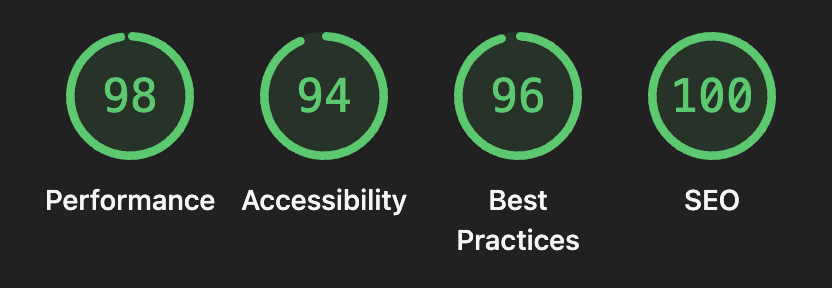
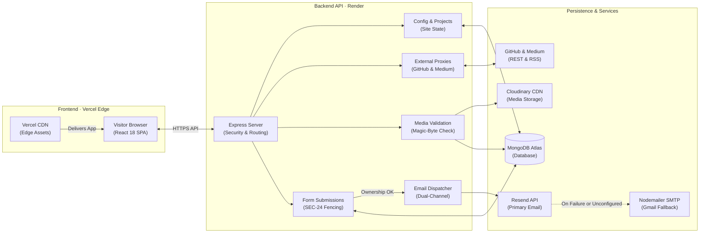

<div align="center">

# googleMe

### A Google-inspired, full-stack developer portfolio and headless CMS engineered for intent-driven search, fast client-side navigation, and resilient operations.

[](https://www.anuragjaiswal.me)
[](https://github.com/anurag-jaiswal-aj/googleMe/actions/workflows/ci.yml)
[](docs/TESTING.md)
[](https://nodejs.org/)
[](LICENSE)

<br />

<p align="center">
  
</p>
<p align="center"><sub>Audit snapshot taken from <code>./lighthouse.png</code> against a production build. Live scores vary depending on client network conditions, device capabilities, and geographic routing.</sub></p>

[Live Demo](https://www.anuragjaiswal.me) · [Architecture](docs/ARCHITECTURE.md) · [API Reference](docs/API.md) · [Security](docs/SECURITY.md) · [Testing](docs/TESTING.md) · [Deployment](docs/DEPLOYMENT.md) · [Configuration](docs/CONFIGURATION.md)

</div>

---

## Overview

**googleMe** transforms the conventional developer portfolio from a passive, vertical-scroll page into an authentic, interactive **Google Search Engine Results Page (SERP)**. Rather than forcing recruiters and engineers through arbitrary animations, googleMe offers zero-friction discovery through keyword-scored routing, sticky category tabs, contextual Knowledge Graph panels, voice search, and an integrated headless CMS.

Behind the Google UI lies a hardened full-stack architecture backed by **386 automated integration tests** (153 client + 233 server), distributed submission idempotency with worker lease fencing (SEC-24), dual-channel email failover (Resend primary with Nodemailer SMTP fallback), binary magic-byte upload validation, and WHATWG URL canonicalization.

### Key Features
- **Authentic Google SERP UX:** Sticky search header, category tabs (All, About, Projects, Blog, Tools, Images, Contact), sitelinks, and breadcrumbs.
- **Smart Search Router:** Scores keyword intent (`"resume"`, `"github"`, `"hire"`) to route directly to relevant tabs, with dynamic visibility-aware fallbacks.
- **Knowledge Graph & 3D Avatar:** Right-rail profile card with bio chips, education, work history, and an interactive 3D flip avatar.
- **Headless Admin CMS:** Authenticated dashboard (`/admin`) to update bio, experience, skills, pinned GitHub repositories, gallery media, and page visibility without redeploying.
- **Client-Side AI & Voice Search:** Zero-latency pattern-matching AI assistant and native Web Speech voice dictation.
- **Resilient Operations:** Distributed submission idempotency, fail-closed startup validation, in-memory caching with automatic eviction, and dual-provider email failover.

---

## Technical Documentation

Detailed architectural deep dives, security specifications, API contracts, and operational guides have been organized into the [`docs/`](docs/) directory:

| Document | Focus & Coverage |
|---|---|
| [**Architecture**](docs/ARCHITECTURE.md) | Decoupled MERN design, Mermaid flowchart, client/server boundaries, and design decisions |
| [**API Reference**](docs/API.md) | REST endpoints, request/response formats, payload limits, status codes, and auth headers |
| [**Security Hardening**](docs/SECURITY.md) | SEC-01 through SEC-24 controls, idempotency engine, magic bytes, and threat considerations |
| [**Automated Testing**](docs/TESTING.md) | Suite breakdown (153 client + 233 server = 386 tests), test count reconciliation, and CI |
| [**Deployment & Operations**](docs/DEPLOYMENT.md) | Vercel edge frontend, Render backend, proxy rules, and production smoke-test checklist |
| [**Configuration & Setup**](docs/CONFIGURATION.md) | Server and client environment variable reference, secret generation, and local run guide |
| [**Limitations & Roadmap**](docs/LIMITATIONS.md) | Confirmed architectural boundaries, operational caveats, and documented project roadmap |

---

## Tech Stack

| Domain | Technologies |
|---|---|
| **Frontend** | React 18 (SPA), Vite 5, React Router v6, Tailwind CSS, Framer Motion, `@dnd-kit`, DOMPurify |
| **Backend** | Node.js (`>=22.22.0 <23.0.0`), Express 4, Multer, Helmet, `express-rate-limit`, `express-validator` |
| **Persistence & Media** | MongoDB Atlas, Mongoose 8, Cloudinary CDN (auto-transcoding WebP, responsive resizing) |
| **Integrations** | Resend API (primary email), Nodemailer (SMTP fallback), GitHub REST API, Medium RSS |
| **Testing & CI** | Node.js Test Runner (`node:test`, `node:assert`), GitHub Actions (Node 22, `mongo:6.0` container) |
| **Deployment** | Vercel Global Edge Network (client SPA), Render Web Service (backend API) |

---

## System Architecture


*For detailed request lifecycles, execution boundaries, and the extended component flowchart, see [docs/ARCHITECTURE.md](docs/ARCHITECTURE.md).*

---

## Quick Start

### Prerequisites
- **Node.js:** `>=22.22.0 <23.0.0`
- **npm:** `>=10.0.0`
- **MongoDB:** Local instance (`mongodb://localhost:27017`) or [MongoDB Atlas](https://www.mongodb.com/atlas) URI

### Installation & Local Run
```bash
# 1. Clone repository & install dependencies across all workspaces
git clone https://github.com/anurag-jaiswal-aj/googleMe.git
cd googleMe
npm run install:all

# 2. Configure environment files
cp server/.env.example server/.env
cp client/.env.example client/.env

# 3. Generate required secrets and update server/.env:
# JWT Secret: node -e "console.log(require('crypto').randomBytes(48).toString('hex'))"
# Admin Hash: node -e "require('bcryptjs').hash('yourpassword', 10).then(console.log)"

# 4. (Optional) Seed initial profile data and project cards
npm run seed

# 5. Start development servers concurrently
npm run dev
```

The frontend will be available at `http://localhost:3000` (or `http://localhost:5173`) and the backend API at `http://localhost:5000`.

*For detailed variable definitions and production settings, see [docs/CONFIGURATION.md](docs/CONFIGURATION.md).*

---

## Automated Testing

The test suite runs on the native Node.js test runner (`node:test`, `node:assert`), requiring zero third-party testing dependencies:

```bash
# Run all 153 client tests (sanitizers, routing, visibility, theme, idempotency)
cd client && npm test

# Run all 233 server tests (uploads, auth, validation, security, idempotency)
cd server && npm test
```

**Test Baseline:** **386 passed**, 0 failed across 17 test files. Continuous integration runs on GitHub Actions under Node.js 22 with an isolated `mongo:6.0` service container.

*For suite breakdowns, test count reconciliation, and CI configurations, see [docs/TESTING.md](docs/TESTING.md).*

---

## Author & Contact

**Anurag Jaiswal**<br />
*Full-Stack Developer & Software Engineer*<br />
Bachelor of Engineering in Computer Science & Engineering (B.E. CS)<br />
Visvesvaraya Technological University (VTU) · Bengaluru, India

- **Portfolio:** [anuragjaiswal.me](https://www.anuragjaiswal.me)
- **GitHub:** [@anurag-jaiswal-aj](https://github.com/anurag-jaiswal-aj)
- **LinkedIn:** [therightrag](https://www.linkedin.com/in/therightrag/)
- **Repository:** [github.com/anurag-jaiswal-aj/googleMe](https://github.com/anurag-jaiswal-aj/googleMe)

---

## License

This project is licensed under the **MIT License**. See the [LICENSE](LICENSE) file for details.
