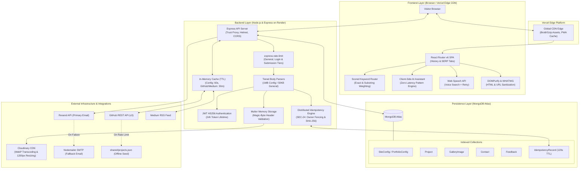

# System Architecture

This document details the architectural principles, component responsibilities, request lifecycles, and design decisions behind **googleMe**.

For a high-level overview, see the root [README.md](../README.md). For related details, see [API Reference](API.md), [Security Hardening](SECURITY.md), [Configuration](CONFIGURATION.md), and [Deployment](DEPLOYMENT.md).

---

## 1. Product Vision & Architecture Philosophy

### The Problem with Traditional Portfolios
Conventional developer portfolios are typically built like static marketing landing pages:
1. **High Discovery Friction:** Recruiters and hiring managers must scroll past multiple viewport heights of vertical animations to find specific projects, tools, or education details.
2. **Static & Fragile:** Content updates require source code edits, commits, and redeployments, leading to stale or abandoned pages.
3. **Superficial Engineering:** Frontends frequently mask absent backend services, lacking authentication, persistent schemas, rate limiting, and automated testing.

### The googleMe Approach: Intent-Driven Discovery
googleMe approaches portfolio presentation as a search problem:
- **Zero-Friction Navigation:** Searching keywords like `"resume"`, `"github"`, `"skills"`, `"contact"`, or `"projects"` immediately routes the visitor to the corresponding result tab via a scored keyword heuristic.
- **SERP Fidelity:** Every view preserves authentic Google search patterns, including breadcrumbs, sitelinks, collapsible Knowledge Graph panels, category filter tabs, and responsive search inputs.
- **Decoupled Headless CMS:** An integrated, authenticated management panel (`/admin`) allows dynamic editing of bio details, work history, skill taxonomy, pinned GitHub repositories, gallery media, and page visibility toggles without code changes.
- **Fail-Closed Reliability:** Server startups abort if required database indexes or configuration secrets are uninitialized, media uploads enforce binary header inspection, and external API requests fall back to deterministic static fixtures when third-party services degrade.

---

## 2. Decoupled System Architecture

googleMe is structured as a decoupled full-stack application. The frontend is a single-page application (SPA) deployed to Vercel's global edge network. The backend is an Express API running on Render backed by MongoDB Atlas, Cloudinary media storage, and dual email dispatch providers.



---

## 3. Request Flow & Execution Boundaries

1. **Client-Side Processing:** Search scoring, query autocomplete filtering, Web Speech voice capture, AI chat pattern evaluation, and 3D avatar flips run entirely in browser memory with zero server round-trips.
2. **Edge CDN Distribution:** Static bundles, route chunks, compressed assets (Brotli/Gzip), and PWA service worker manifests are served via Vercel's global edge network.
3. **Synchronous Backend Boundaries:** Admin authentication, configuration updates, and gallery mutations run synchronously against MongoDB and Cloudinary.
4. **Asynchronous & Resilient Background Tasks:** Contact form and feedback submissions acquire distributed idempotency locks, persist payloads, verify worker lease ownership, and dispatch email notifications via Resend with automatic fallback to Nodemailer SMTP.

---

## 4. Key Engineering & Design Decisions

### Scored Keyword Routing with Visibility Awareness
- **Problem:** Visitors use varied search terminology. Static routing tables fail on synonyms or misspellings, while standard full-text search engines require heavy server round-trips for simple client-side navigation.
- **Implementation (`client/src/utils/searchRoute.js`):**
  Search queries are evaluated across registered route definitions using a weighted priority function:
  $$\text{Score} = (\text{exact match} \times 2 + \text{keyword length}) + (\text{partial match} + \text{keyword length} \times 0.5)$$
  High-confidence intent matches immediately route the user to the target tab (`"projects"`, `"github"`, `"repo"` $\to$ `/projects`; `"hire"`, `"email"`, `"reach"` $\to$ `/contact`).
- **Visibility Awareness:** The search router evaluates the active `pageVisibility` state before redirecting. If an administrator has hidden a section (e.g., the Gallery or Tools page), query matches targeting that route gracefully fall back to `/all?q=...` instead of triggering a 404 error.

### In-Memory Caching & Automatic Eviction
- **Problem:** The GitHub REST API imposes a strict rate limit of 60 requests per hour for unauthenticated callers. Medium RSS feeds are subject to third-party network latency and rate limiting.
- **Implementation (`server/routes/github.js`, `server/routes/medium.js`, `server/routes/config.js`):**
  - GitHub repositories and Medium articles are cached in memory with a 30-minute time-to-live (TTL).
  - Site configuration is cached in memory with a 60-second TTL.
  - When an administrator modifies `githubUsername` or `mediumUsername` via `/admin`, the backend invalidates the corresponding external cache, ensuring updates take effect immediately without a server restart.
  - If the GitHub API fails or exceeds rate limits, the server falls back to static fixtures stored in `shared/projects.json`.

### Dual-Channel Resilient Email Delivery Pipeline
- **Problem:** Email deliverability is critical for contact forms. Third-party transactional email providers (such as Resend) can experience regional outages, rate limit spikes, or domain verification delays.
- **Implementation (`server/utils/emailService.js`):**
  - When a message is submitted, the system attempts delivery via **Resend** (HTTP API, preferred).
  - If Resend credentials are unset, or if the API call encounters a network/HTTP error, the system automatically falls back to **Nodemailer SMTP** (e.g., Gmail over TLS/SSL on port 465).
  - All email triggers verify idempotency lease ownership before dispatch, guarding against rapid client retries and duplicate email delivery during concurrent worker execution.

---

## 5. Technology Stack Breakdown

| Layer | Technologies | Rationale |
|---|---|---|
| **Frontend Framework** | React 18.3.1, Vite 5.4.21 | Single Page Application with fast HMR and optimized chunk splitting |
| **Routing** | React Router v6.30.6 | History API management, SERP tabs, and dynamic redirect fallback |
| **Styling & Motion** | Tailwind CSS 3.4.19, Framer Motion 11.0.8 | Google-themed design fidelity, responsive grids, and smooth transitions |
| **Client Utilities** | DOMPurify 3.4.16, native WHATWG URL | Strict client-side sanitization of RSS content and external gallery links |
| **Backend Runtime** | Node.js (`>=22.22.0 <23.0.0`), Express 4.18.3 | High-concurrency event-driven API runtime matching CI environment |
| **Security Middleware** | Helmet 7.1.0, CORS 2.8.5, express-rate-limit 7.2.0 | Defense-in-depth header protection and multi-tiered rate limiting |
| **Database & ODM** | MongoDB 6.0+, Mongoose 8.2.3 | Document persistence, index initialization, and TTL expiration |
| **Media & Storage** | Cloudinary 2.9.0, Multer 2.1.1 | Binary magic-byte upload validation and automated WebP optimization |
| **Email Delivery** | Resend API, Nodemailer 10.1.0 | Primary transactional HTTP API with automatic SMTP failover |
| **Testing** | Node.js Test Runner (`node:test`, `node:assert`) | Native, zero-dependency unit and integration test execution |

---

## 6. Repository Organization

```
googleMe/
├── .github/
│   └── workflows/
│       └── ci.yml               # GitHub Actions CI workflow (Node 22, MongoDB 6.0 service)
├── client/                      # React 18 + Vite frontend SPA
│   ├── public/                  # Static assets (Resume PDF, favicon.svg, sitemap.xml, robots.txt)
│   ├── src/
│   │   ├── api/                 # Axios HTTP client, auth interceptors, and typed API services
│   │   ├── components/          # Reusable UI (SearchLayout, KnowledgePanel, 3D Avatar, SearchResult)
│   │   ├── config/              # Default configuration constants and navigation links
│   │   ├── context/             # ThemeContext (dark, light, system preference resolution)
│   │   ├── data/                # Static fallback fixtures (bio, education, experience, tools)
│   │   ├── hooks/               # Custom hooks (useConfig, useVoiceSearch, useImagesPageEnabled)
│   │   ├── pages/               # Route views (Home, All, About, Projects, Blog, Tools, Images, Contact, Admin)
│   │   └── utils/               # Heuristics (aiChat, searchRoute, galleryUrl, sanitizeHtml, idempotency)
│   ├── test-*.js                # 10 standalone frontend test suites (153 automated tests)
│   ├── vercel.json              # Vercel deployment config (SPA rewrites, security headers, cache policies)
│   └── vite.config.js           # Vite bundling, PWA manifest, and Brotli/Gzip compression pipeline
├── docs/                        # Modular technical documentation
│   ├── ARCHITECTURE.md          # System architecture, request flows, and design decisions
│   ├── API.md                   # REST API endpoint reference and payload specifications
│   ├── SECURITY.md              # SEC-01 through SEC-24 controls, idempotency, and threat notes
│   ├── TESTING.md               # Test suite breakdown (386 tests), reconciliation, and CI workflow
│   ├── DEPLOYMENT.md            # Vercel and Render deployment guides and operational checks
│   ├── CONFIGURATION.md         # Environment variables reference and local setup instructions
│   └── LIMITATIONS.md           # Confirmed boundaries, operational caveats, and roadmap
├── server/                      # Express + MongoDB backend API
│   ├── middleware/              # Authentication middleware (strict HS256 JWT validation)
│   ├── models/                  # Mongoose schemas (SiteConfig, Project, GalleryImage, Contact, Feedback, IdempotencyRecord)
│   ├── routes/                  # Modular route controllers (adminAuth, config, contact, feedback, github, images, medium, projects)
│   ├── scripts/                 # Database seed utility (scripts/seed.js)
│   ├── utils/                   # Shared backend utilities (idempotency, emailService, attachmentValidation, imageValidation)
│   └── test-*.js                # 7 standalone backend test suites (233 automated tests)
├── shared/
│   └── projects.json            # Deterministic project fallback data for offline or rate-limited environments
├── lighthouse.png               # Verified Lighthouse audit score snapshot (95/98/96/100)
├── LICENSE                      # MIT Open Source License
└── package.json                 # Monorepo management scripts (dev, dev:server, dev:client, install:all, build, seed)
```
